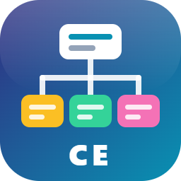
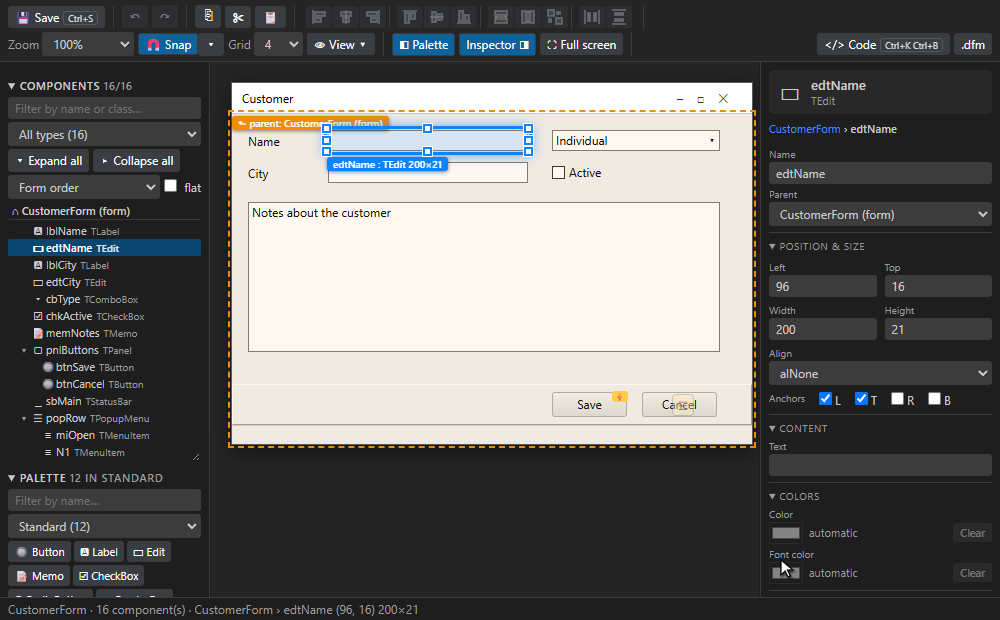
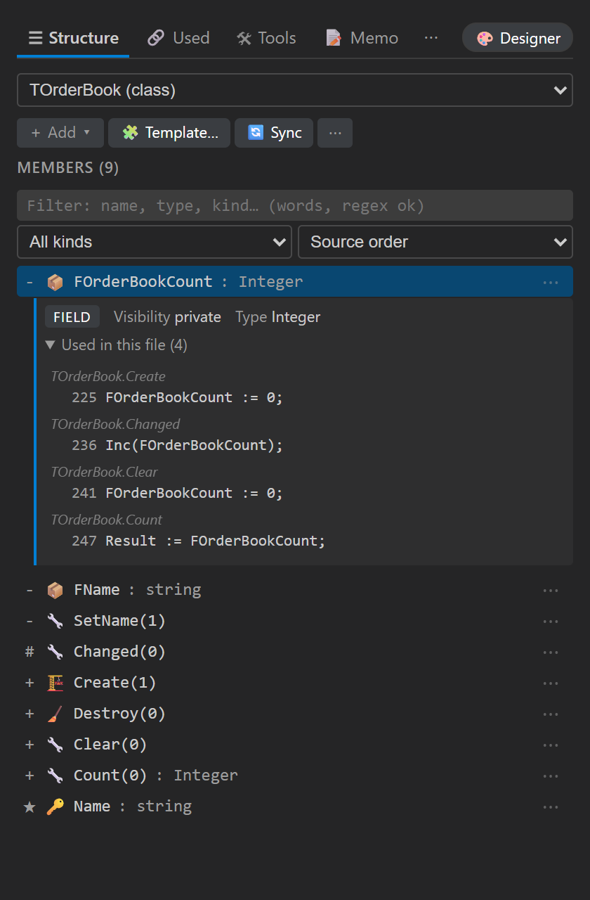
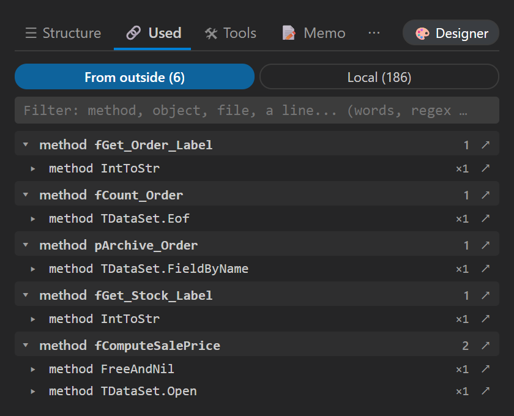
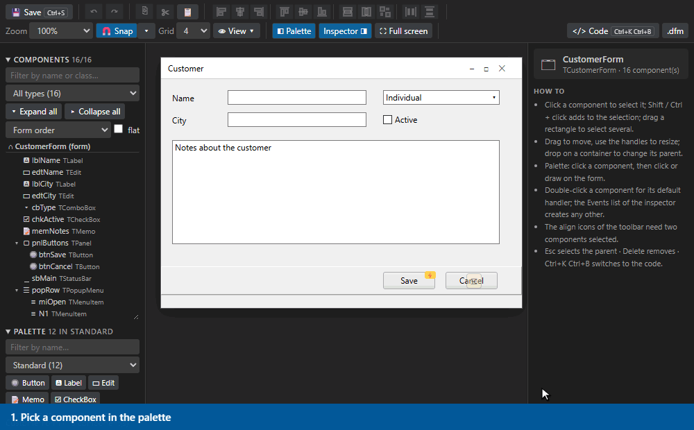
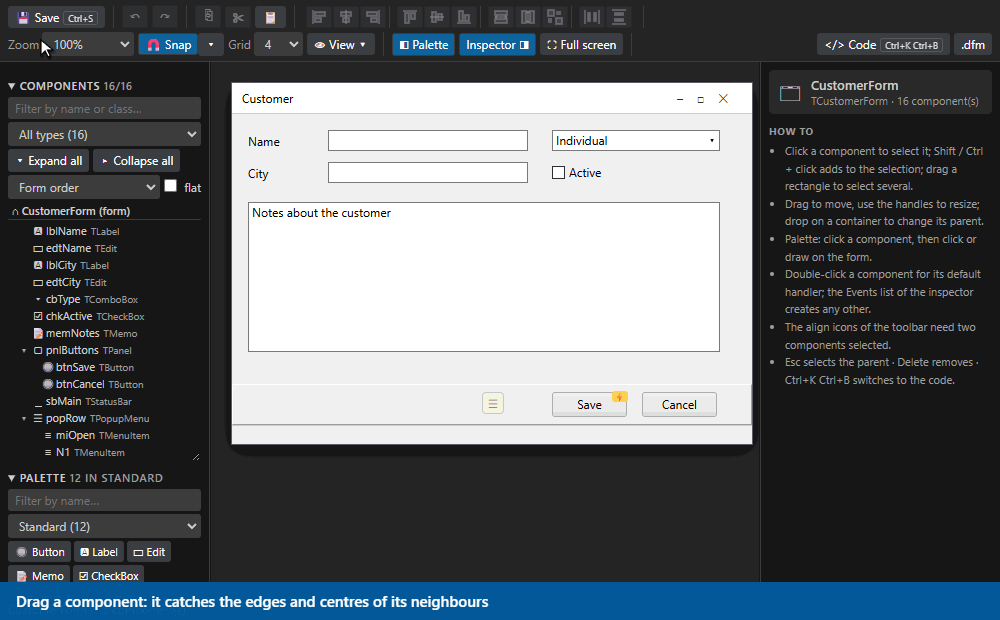

<p align="center"></p>

# CE Code Explorer

**A structure view, a refactoring toolbox and a Delphi form designer for VS Code.**

Browse, create, edit and refactor classes and members across **9 languages** (Pascal / Delphi, C++, Rust, Java, Python, C#, Go, TypeScript / JavaScript and PL/SQL), read the routines of Batch, PowerShell, Shell and Markdown files, and see what a file really uses: the objects of the files it points to, and its own local variables and routines.

It adds to VS Code what a Delphi developer misses in it (a structure of the unit, the visual form designer, the checks between `.pas` and `.dfm`) and what any language gains from it (safe refactoring, review, project-wide views). It works next to OmniPascal, the TypeScript server and the other extensions: it never changes the language VS Code gives a file, and nothing is read in the background.

> Status: pre-1.0 (`0.1.x`). Every release is listed in the [changelog](CHANGELOG.md).

<p align="center"></p>

## Contents

- [Install](#install) · [Quick start](#quick-start) · [Supported languages](#supported-languages)
- [The sidebar](#the-sidebar) · [Members and refactoring](#members-and-refactoring) · [Moving around](#moving-around)
- [Used: what a file uses](#used-what-a-file-uses) · [Blueprint](#blueprint) · [Review and dead code](#review-and-dead-code)
- [Delphi](#delphi) · [PL/SQL](#plsql-oracle) · [Translation](#translation) · [More tools](#more-tools)
- [Keyboard shortcuts](#keyboard-shortcuts) · [Settings](#settings) · [Privacy](#privacy-and-network) · [Development](#development) · [License](#license)

## Install

Requires VS Code 1.85 or later.

**From a `.vsix`** (Extensions view → `…` → *Install from VSIX…*, or the command line):

```bash
code --install-extension ce-code-explorer-0.1.112.vsix
```

**From source:**

```bash
git clone https://github.com/hug0O/ce-explorer.git
cd ce-explorer
npm ci
npm run build                          # bundles src/extension.ts -> dist/extension.js
npx @vscode/vsce package --no-dependencies
code --install-extension ce-code-explorer-*.vsix
```

Then reload the window (`Developer: Reload Window`). The **Code Explorer** icon appears in the activity bar.

## Quick start

1. Open a source file and click the Code Explorer icon. The **Structure** tab lists the members of the file.
2. Click a member: its kind, its parameters and **where it is used in the file** open right under its row. The **⋯** button of a row has *Edit*, *Rename*, *Move to…*, *Delete*, *Doc header*.
3. Press **`Ctrl+K Ctrl+A`** and type what you want to do in your own words (`rename`, `translate form`, `dead code`…): the actions that fit the file come up, the ones you use most first.
4. Press **`Alt+G`** to jump to a member by typing a few letters, **`Alt+M`** to filter the sidebar on the name under the cursor.
5. Open the **Used** tab to see which objects of other files the code writes, and which local variables nothing uses.

## Supported languages

| Language | Extensions |
|----------|-----------|
| Pascal / Delphi | `.pas` `.dpk` `.dpr` |
| C++ | `.h` `.hpp` `.cpp` `.cc` `.cxx` `.hxx` |
| Rust | `.rs` |
| Java | `.java` |
| Python | `.py` |
| C# | `.cs` |
| Go | `.go` |
| TypeScript / JavaScript | `.ts` `.tsx` `.js` `.jsx` |
| PL/SQL | `.pks` `.pkb` `.sql` `.txt` |
| Batch (Windows) | `.bat` `.cmd` (labels are routines, `set` is variables) |
| PowerShell | `.ps1` `.psm1` (functions, classes, variables) |
| Shell (sh / bash / zsh) | `.sh` `.bash` `.zsh` `.ksh` (functions, variables) |
| Markdown | `.md` `.markdown` (the headings are the members) |

A file the extension does not recognise can be given a language by hand: **CE: Use a language for this file…**, or the *Language of this file* drop-down of the Tools tab (this file, or every file with its extension). `.txt` files are read as PL/SQL only when they really contain SQL.

## The sidebar

<p align="center"></p>

The **Member** view has four tabs, plus a folded **Changelog + Guide** view below it.

| Tab | What it is for |
|---|---|
| **Structure** | The members of the file (or of the type you pick), by source order, visibility, kind or A → Z. A live filter, an **Add** menu (method, field, property, constructor), templates, declaration ⇄ implementation sync. The selected member shows its kind, parameters, **where it is used in the file** (highlighted in the editor), its variables and a search inside its code. |
| **Used** | What the code of the open file uses: the objects of the files it points to, and what belongs to the file itself. See [below](#used-what-a-file-uses). |
| **Tools** | Align a selection on a string, the Delphi tools, the PL/SQL tools, review / documentation / dead code, the Blueprint, the project panel. Only the pages that apply to the active file are shown. |
| **Memo** | Markdown notes: a `main.md` and as many other memos as you create, opened as a page (outline, tick boxes, `/` menu) or as plain text. They can live in the project folder (`ce.memo.folder`) and be versioned. |
| ⋯ **Shortcuts** | Every shortcut of the extension, by mode. |

**One filter for the lists.** Structure, *Used → From outside* and *Used → Local* share the same filter: words in any order, each one a regular expression or plain text, any case. The text is kept when you change tab. **`Alt+M`** (or *Filter Members*) puts the name under the cursor in the filter of the tab that is open.

## Members and refactoring

- **Add** a method, field, property or constructor with a form that previews the code in the target language; edit a signature while keeping the body; **reorder parameters** with the arrows (the calls of the open file follow, on request).
- **Rename** is one command: on a member it renames it everywhere the language needs (declaration and implementation, the `.dfm`, the header and the source), on a variable it renames the variable, anywhere else it renames the name in **the whole project with the VS Code refactoring preview** (every place listed, comments and strings told apart, one Undo).
- **Move** a member to another type, **delete**, **extract method**, **implement an interface / override**, **generate getters and setters**, **synchronise declaration and implementation** (C++ header and source, Pascal interface and implementation).
- **Safe Preview** (`ce.previewEdits`, off by default) shows a diff and asks before any structural edit. Every edit made by the extension is one undoable change, and the message that reports it has an **Undo** button.
- **Templates** with VS Code snippet syntax, per language, from `.vscode/ce-templates.json` or the global storage; managed from the sidebar.
- **Align selection** on a string (`:=`, `=`, `//`…) in any language.

## Moving around

| Key | Action |
|---|---|
| `Alt+G` | Go to a member by typing a few letters |
| `Alt+M` | Filter the sidebar on the element under the cursor |
| `Alt+Enter` | Declaration ⇄ implementation |
| `Ctrl+Shift+Up` / `Down` | Previous / next member (or heading in Markdown) |
| `Ctrl+K Ctrl+M` | Open Structure |
| `Ctrl+K Ctrl+A` | **Quick actions**: search every action of the extension in plain words, grouped, with your own most used first |

*Go to member in the workspace* searches the symbols of every file. A status bar item shows the language the extension reads the file as, warns when accents look wrong, and opens a small menu (quick actions, designer, structure, memo, tip of the day).

## Used: what a file uses

<p align="center"></p>

The **Used** tab answers "where does this come from, and where is it used?" without indexing the project.

- **From outside**: the objects of the files the open file points to (the units of a `uses` clause, the `#include`s, the imports of TypeScript / JavaScript, Python, Java, C#, Go and Rust). Only those files are read: the names of the project's files are listed once and the few that are used (a few dozen, never the whole project, so it works on a project of 20 000 files) are read without being opened, and kept by the date of each file. Objects are written `<file>.<object>`: classes, members, routines, constants, variables, types and enumeration values, generic types included. Constructors and destructors are left out.
- **Local**: the local variables and parameters of each routine, the routines declared inside another one, and the variables, constants, types and routines of the file itself. An object that nothing uses is listed with no line, which shows the unused variables.
- **By method.** Both lists are grouped by the routine of the open file. Unfold an object to see **where it is defined** (a click opens it, or goes to the declaration) and **the lines that write it**, under the routine that holds them (a click goes to the line). The filter works on the routine and on the object apart: type a routine to see all its objects, an object to see it under its routine.
- Keyboard: arrows move along routines, objects and lines, Right / Left unfold and fold, Enter unfolds or goes to the line, **O** opens the definition.

## Blueprint

**CE: Blueprint of this file** draws the routines of a file as nodes (parameters on the left, the return value on the right) and the calls between them as wires, in the manner of a game-engine blueprint, in every language that has routines.

- Drag a node by its title; drag from a white arrow to another node to **write the call in the code**; click a wire and press Delete to remove the call; **F2** renames a routine and every call follows; double-click a node to open its code, double-click the canvas to add a routine. The picture is read again from the text, so editing the code redraws it.
- Selecting a node lights its **whole chain** of callers (above) and callees (below), with their distance (`↑2`, `↓3`). The filter keeps the parents and children of what matches. *Simple view* hides the editing buttons.
- **File | Project** switches to the **units of the whole project** and the imports between them (the `uses` of Delphi, the imports of the other languages): drag from a unit to another to write the `uses`.
- Unused routines and loops of calls are marked; the graph can be exported as **Mermaid** or **SVG**.

## Review and dead code

**CE: Code Review** (Tools tab → Analyze) reports findings of three severities (error, warning, advice) with a message, a hint on how to fix it, and **the code the compiler or linter of the language gives the same problem** (`H2164`, `CS0168`, `TS6133`, `F401`, `-Wunused-variable`, `errcheck`…). Findings are squiggles in the editor and entries of the Problems panel, and what the language servers of other extensions already report is listed in the same report. The rules read the text only and do not replace a build.

- Rules per language: Delphi / Pascal (the compiler's warnings and hints, objects never freed, `except` that swallows, SQL built by concatenation…), TypeScript / JavaScript, Java, C#, C++, Go, Rust, Python, PL/SQL, and rules common to all (CWE-89 / 327 / 295, passwords in the source, long methods, notes).
- **Dead code** lists what the compiler or linter of the language says is unused (imports, locals, private members, unreachable code) and, in the project panel, units and components that nothing uses. Findings are also shown dimmed in the editor.
- **Documentation**: Markdown API docs from the structure of a file; *Export structure*.

## Debugging

**CE: Debug this file** (the 🐞 *Debug* button of the Tools tab, the *More commands* menu, or `F5` in a Pascal file) starts the debugger that fits the language of the file, with the breakpoints you set in the gutter (`F9`). The extension allows breakpoints in Pascal, PL/SQL, Batch and every language that has a debugger, so the red dot is there even before the debug extension is installed; **CE: Toggle breakpoint on this line** does the same from the keyboard or the menu, and `debug.allowBreakpointsEverywhere` in the VS Code settings allows them in any file.

**Delphi / Pascal: a debugger of its own.** It debugs the program a Delphi project builds, Win32 or Win64, on Windows, with nothing to install: the debug engine is compiled by PowerShell the first time.

- **Build from VS Code.** `Ctrl+Shift+B` (or **CE: Build the project**, the 🔨 *Build* button of the Tools tab) compiles the `.dproj` of the open unit with the Delphi compiler: it finds the RAD Studio installed (registry, `BDS`, the usual folders, or `ce.delphi.rsvars`), runs MSBuild with its environment, and puts the compiler's **errors and warnings in the Problems panel**, each on its file and line. *Rebuild* is there too. The configuration and platform are `ce.delphi.buildConfig` (`Debug`) and `ce.delphi.platform` (`Win32` or `Win64`).
- **Clean, Build, Rebuild, Install, in 32 and 64 bit.** **CE: Clean / Build / Install the project** (the 🧹 🔨 📦 buttons of the Tools tab) ask for the platform: *Win32*, *Win64* or both, one after the other. *Install* copies the program built to `ce.delphi.installDir`. **CE: Delphi - Rebuild the project** rebuilds everything. In the other languages the same three commands run the tool of the project found in the folder (cargo, go, dotnet, Maven, Gradle, CMake, make, npm, pip), in 32 or 64 bit where the tool has both.
- **F5 builds first.** Debugging builds the project (with the **detailed map file forced on**, whatever the project options say), stops with the errors if there are any, and otherwise starts the program under the debugger: edit, F5, breakpoint. Set `"build": false` in `launch.json` to debug the program as it is.
- **What it does**: breakpoints on the lines of your units (a line without code moves to the next one that has some), run, **pause**, **step over / step into / step out** by source line, **call stack** with routines and lines, the **registers** of the stopped frame, the program's `OutputDebugString` text in the debug console, and a stop on an exception or (option `breakOnAccessViolation`) on an access violation. The program and its map file are found from the open unit (`Win32\Debug`, `Win64\Debug`, the project folder) or set with `program` and `mapFile` in `launch.json`.
- **What it does not do yet**: show the values of variables, evaluate expressions or watches (Delphi's types are not in the map file), conditional breakpoints, and attach to a running process.

**Other languages: one command, the debugger each language already has.** It builds the launch configuration for the file, and offers to install the extension that brings the debugger when it is missing.

| Language | Debugger started |
|---|---|
| JavaScript, TypeScript | Node.js (built into VS Code; TypeScript through `tsx`) |
| Python | Python Debugger (`ms-python.debugpy`) |
| Java | Debugger for Java (`vscjava.vscode-java-debug`) |
| C# | .NET (`coreclr`, the C# extension) |
| Go | Go (`golang.go`) |
| Rust | CodeLLDB (`vadimcn.vscode-lldb`) |
| C / C++ | C/C++ (`cppvsdbg` on Windows) |
| PowerShell | PowerShell extension |
| Shell | Bash Debug |

Batch, PL/SQL and Markdown have no debugger.

## Delphi

<p align="center"></p>
<p align="center"></p>

- **Visual form designer** (`Ctrl+K D`, the title bar of a `.pas` / `.dfm`, the status bar). Select, drag, resize, align and distribute (with magnetism and guide lines), add components from a palette, copy / paste (as name and caption, or as a whole), undo. VCL, **DevExpress**, **TMS**, UniDAC and TeeChart components are drawn; queries show their fields, grids their columns; bars, tiles, menus and popup menus are edited in place. Events are created and opened from the inspector, and the unit and the `.dfm` stay in step. A component changes parent only while **Ctrl** is held during the drop.
- **Checks between `.pas` and `.dfm`**: *Check form* (`Ctrl+K C`) finds missing and orphan handlers, a field declared with another class, duplicate TabOrder, controls outside their container, persistent fields whose class is not the one of their column's domain, and fixes what is safe. Handlers are renamed and removed with their component.
- **Project panel** (`Ctrl+K I`, scanned only when you ask): every SQL statement of the forms and the code, unused units / components / SQL parameters, checks of every form, the texts of the forms grouped by meaning (CSV export), component names against the convention of the project, the forms by ancestor, hotspots from `git log`, and a **component-by-component comparison of a form with a git version**.
- **Translate the form**: the captions, hints and titles of a `.dfm` are translated and written to the memo `translate_<language>.md`, one section per form, each translation checked before it is written. See [Translation](#translation).
- Forms can be generated from a list of fields or from a class; a component's class can be changed; third-party classes are learned from the `.dfm` files of the workspace or described in `ce.delphi.customComponents`.
- Pascal routines declared inside a routine are listed under it in Structure; generic types (`TBox<T>`) are read as classes.

## PL/SQL (Oracle)

Package specifications and bodies, stand-alone procedures and functions, triggers, anonymous blocks and `CREATE TABLE` columns appear in the structure (`.pks .pkb .pck .pls .plb .prc .fnc .trg .sql`, and `.txt` only when it contains SQL). Tools: package skeletons, `SELECT` / `INSERT` / `UPDATE` / `DELETE` / `MERGE` from a `CREATE TABLE`, spec ⇄ body sync, exception blocks, PLDoc headers, utPLSQL tests, extract procedure, find callers, Oracle-specific review rules.

## Translation

**CE: Translate the selection** translates a selected text with the free [MyMemory](https://mymemory.translated.net) service (no key, no account), shows the result and lets you replace the selection or copy it. The source and target languages are set with *Translate into…* / *Translate from…* (a translation made here is translated again from its original, not from the translation). The first time, the extension says exactly what is sent and asks for your agreement.

## More tools

- **Quick actions** (`Ctrl+K Ctrl+A`) and the **status bar menu** find any command by what it does; the palette lists every command with the prefix `CE:`.
- **Fix encoding (accents)**: repairs UTF-8 read as Windows-1252 in place, and reads a Windows-1252 file (what Delphi writes) as such.
- **Feature usage** (`CE: Help` → *Feature usage*): which features you use most and least, counted **on your machine only**; the status bar menu suggests one you never ran.
- **Code lens** with member counts, optional Edit / Delete lenses above every member.
- **Guide**: the *Changelog + Guide* view and **CE: Help** hold the user guide, with pictures and animations of the designer.

## Keyboard shortcuts

| Shortcut | Action |
|---|---|
| `Ctrl+K Ctrl+M` | Structure |
| `Ctrl+K Ctrl+A` | Quick actions |
| `Ctrl+K Ctrl+E` | Edit the member under the cursor |
| `Ctrl+K Ctrl+N` | Memo |
| `Ctrl+K Ctrl+B` | Toggle the form designer ⇄ code (Delphi) |
| `Ctrl+K J` | Align the selection on a string |
| `Alt+G` · `Alt+M` · `Alt+Enter` · `Ctrl+Shift+Up/Down` | See [Moving around](#moving-around) |

**Tool shortcuts are `Ctrl+K`, release, then a letter**, shown on the buttons of the Tools tab. Each works only in the files it is about, so the same letter serves both families:

| Delphi (`.pas` `.dfm` `.dpr`) | | PL/SQL (`.pks` `.pkb` `.sql` …) | |
|---|---|---|---|
| `Ctrl+K D` | Open the form designer | `Ctrl+K D` | PLDoc header |
| `Ctrl+K L` | Align components | `Ctrl+K Y` | Sync spec ⇄ body |
| `Ctrl+K N` | Anchors / docking | `Ctrl+K N` | New package |
| `Ctrl+K T` | TabOrder by position | `Ctrl+K G` | SQL from table |
| `Ctrl+K C` | Check form | `Ctrl+K X` | Extract procedure |
| `Ctrl+K H` | Clean handlers | `Ctrl+K E` | Exception block |
| `Ctrl+K Y` / `A` / `K` | Copy / paste / duplicate components | `Ctrl+K T` | utPLSQL tests |
| `Ctrl+K G` / `Q` | Form from fields / from a class | `Ctrl+K L` | Find callers |
| `Ctrl+K E` | Change class | | |
| `Ctrl+K B` | Compare the form with a git version | | |
| `Ctrl+K I` | Project panel (any language) | | |

They avoid the letters VS Code already uses after `Ctrl+K`, and can be rebound like any shortcut. Inside the designer: `Ctrl+S` save · `Ctrl+C` / `X` / `V` · `Ctrl+Z` / `Y` · `Ctrl+A` · `Delete` · arrows (`Shift` = grid step, `Ctrl` = resize) · `Esc` parent / cancel · `P` / `I` / `F` palette, inspector, full screen.

## Settings

| Setting | Default | Description |
|---------|---------|-------------|
| `ce.enableCodeLens` | `true` | Show Code Lens annotations above classes and methods |
| `ce.codeLensMemberActions` | `false` | Edit / Delete lenses above every member |
| `ce.autoSync` | `true` | Synchronise declaration and implementation on save |
| `ce.sorting.scheme` | `fieldsFirst` | Default sorting of class members |
| `ce.previewEdits` | `false` | Show a diff preview before applying structural edits |
| `ce.memo.folder` | empty | Folder of the Markdown memos (relative to the workspace); empty: the extension's storage |
| `ce.translate.target` | `fr` | Language *Translate* translates into |
| `ce.translate.source` | `auto` | Language of the text to translate |
| `ce.translate.email` | empty | Optional e-mail given to MyMemory to raise its daily quota |
| `ce.delphi.designerColumn` | `active` | Where the form designer opens |
| `ce.delphi.designerHideSidebars` | `true` | Hide the side bars while the designer is shown |
| `ce.delphi.designerAutoSave` | `false` | Save the `.dfm` and the `.pas` after every change in the designer |
| `ce.delphi.removeEmptyHandlers` | `true` | Remove empty event handlers on save of a form unit |
| `ce.delphi.customComponents` | `[]` | Third-party components the *Add component* tool should know |
| `ce.delphi.namingPrefixes` | `{}` | Component prefix per class, for the *Names* tab of the project panel |
| `ce.delphi.hostCalls` | `["fAddFormInto"]` | Helpers of the project that put a form in a container |
| `ce.plsql.author` | OS user | Author written in generated PL/SQL headers |
| `ce.pascal.indentSize` | `2` | Indentation of generated Pascal |
| `ce.pascal.defaultVisibility` | `private` | Default visibility for Pascal |
| `ce.cpp.indentSize` | `4` | Indentation of generated C++ |
| `ce.cpp.braceStyle` | `newLine` | Brace placement for C++ |
| `ce.cpp.defaultVisibility` | `private` | Default visibility for C++ |

## Privacy and network

- **Local.** The extension reads the files of your workspace and nothing leaves your machine, with one exception below. Feature usage counts are kept in the extension's own storage and are never sent anywhere.
- **Translation** is the only feature that uses the network. When you translate, **the selected text** (or the captions of a form) is sent to `api.mymemory.translated.net`, a free service, **after you agree** in a dialog that says so. Nothing else of your code is sent. The optional `ce.translate.email` setting, if you fill it, is sent with each request.
- **Nothing runs in the background.** The project panel scans only when asked, in small steps; the *Used* tab reads only the files the open file points to; `git log` is asked only when the *Hotspots* tab is opened.

## Development

```bash
npm ci
npm run build       # esbuild bundle -> dist/extension.js (not in the repository)
npm run watch       # rebuild on change
npm run compile     # tsc --noEmit
npm run lint        # eslint
npm test            # node --test, no VS Code needed (the vscode API is mocked)
npx @vscode/vsce package --no-dependencies
```

- `src/extension.ts` registers the commands; `src/providers/` has one parser per language, `src/services/` the operations and Delphi tools, `src/webview/` the sidebar, designer, Blueprint and panels (webview pages are generated from template strings, with a content-security policy and no inline styles), and `src/utils/` the pure logic that the tests exercise directly.
- `test-fixtures/` has sample files, including Delphi forms (`test-fixtures/delphi/`). The pictures and animations of the guide are produced by `npx tsx tools/guide/make.ts`, those of the sidebar in this page by `npx tsx tools/guide/sidebar.ts` (see `tools/guide`); `test-fixtures/large_unit.pas` is written by `node tools/make-large-unit.js`.
- A change comes with a test, passes `npm run compile`, `npm run lint` and `npm test`, and adds an entry to [CHANGELOG.md](CHANGELOG.md).

## License

[MIT](LICENSE)
